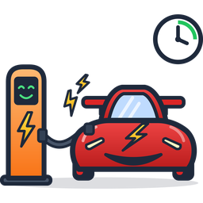
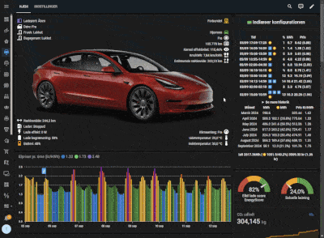
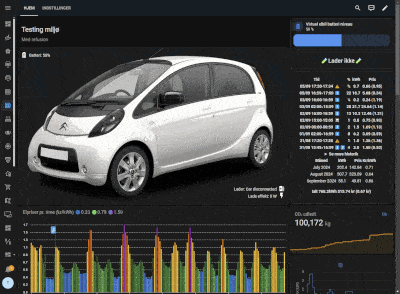
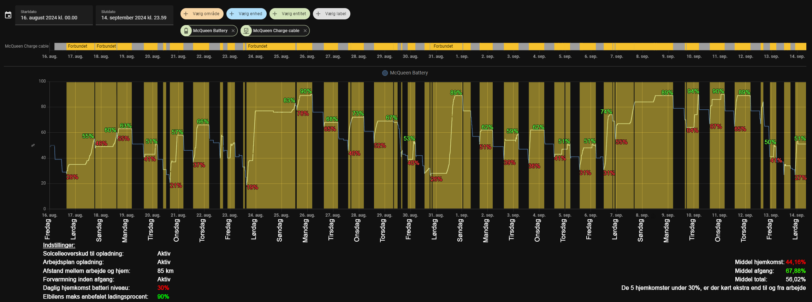
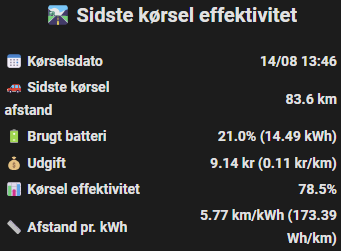
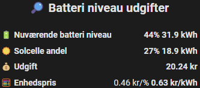
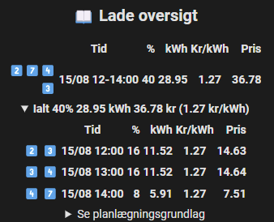
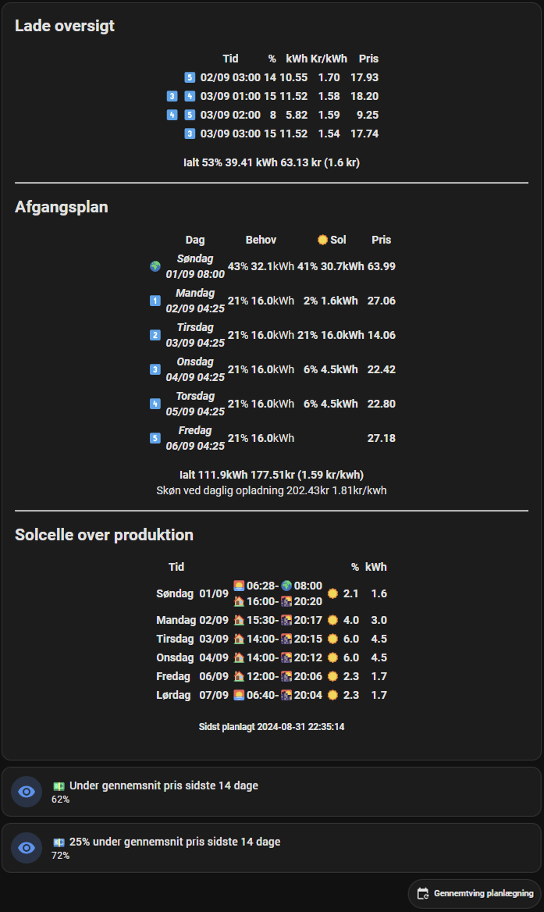
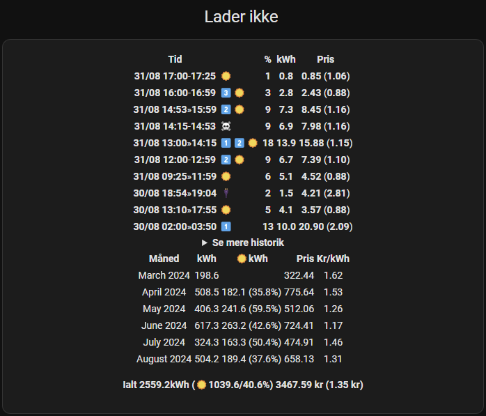
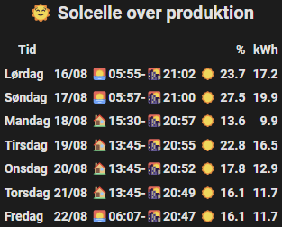

# 🚗Cable Juice Planner🔋🌞📅 for Home Assistant

[](https://hacs.xyz/docs/faq/custom_repositories/)
[](https://github.com/dezito/Cable-Juice-Planner-HACS/releases)
[](LICENSE)

Plans EV charging based on a work plan or the cheapest times over a week.
The plan uses electricity prices, solar surplus, home battery and the car's actual consumption.

> [!NOTE]
> This is the **integration version** of Cable Juice Planner, installed via HACS. It replaces the
> [PyScript version](https://github.com/dezito/Cable-Juice-Planner) and can import its
> configuration and databases. See [Switching from the PyScript version](#switching-from-the-pyscript-version).

> [!IMPORTANT]
> The integration **sends no commands** to the charger or the car. The plan is exposed as
> [action entities](#how-to-control-the-charger-and-the-car), and you control the charger yourself with an
> automation. A [blueprint](#blueprint-charger-control) with fail-safe is included for this.

<a href="https://sloth.nu/tesla_solar_demo.gif" target="_blank"></a><a href="https://sloth.nu/virtual_ev_demo.gif" target="_blank"></a>



---

## Charging rules

- **☀️ Solar surplus charging**
  - The car is charged with the solar panels' surplus production. It can use the whole hour's surplus, even if
    charging only starts later in the hour.
  - Can also be set to X minutes back. With e.g. 15 min the hour is split into four
    (13:00, 13:15, 13:30 and 13:45), and the surplus is used in those intervals.
- **🏢 Work Plan charging**
  - Set the number of kilometres, departure, arrival and preheating per workday. The integration finds the
    cheapest times to charge and preheats the car for departure, if selected.
  - When the car is away on a workday and hasn't come home yet, only the way back (half the distance) is
    left for that day.
  - The km per weekday can be [learned](#learn-driving-distance) from the odometer.
- **📅 Optimal weekly charging (no Work Plan)**
  - Set how many kilometres you typically drive per day. Every day, enough is always charged for that
    distance plus the daily minimum, in the day's cheapest hours. The rest up to the **EV max
    recommended charging limit** (e.g. 90 %) is only charged in the week's cheapest hours (the cheapest 30 %), and
    only if the next 24 hours aren't clearly cheaper.
- **🧳 Trip:** charge to a percentage or to a number of km before a departure, optionally with preheating
- **🔌 Manual charging** (e.g. guests), optionally on solar surplus only
- **🪫 Forced charging below the daily battery level** (up to e.g. 30 %), but not in the most expensive hours
- **💸 Cheap and very cheap power:** charge higher (e.g. 70 % / 90 %) when the power is cheap or extra cheap –
  together with Optimal weekly charging, or on its own with **Charge on cheap power**
- **📈 Full charge every X days** for the battery's sake (above the max recommended limit). It counts as done
  from 99 %, as a cold battery may stop there.

> [!NOTE]
> If all charging rules are turned off, Cable Juice Planner charges like a regular charger at max. current.

## Features

- **EV integration or virtual EV:** without a car in Home Assistant you enter the
  battery level yourself when the cable is plugged in
- **Solar and Solcast (optional):** surplus now and forecast ahead, from
  [Solcast PV Forecast](https://github.com/BJReplay/ha-solcast-solar) and/or own history
- **Home battery (optional):** charge the home battery to a certain level first, and charge the car from
  the home battery above a minimum
- **Multiple cars on the same main fuse:** [load balancing](#multiple-cars-load-balancing) with priority and phase order
- **House consumption** is estimated from own history (excluding car, home battery and ignored consumers)
- **Price providers:** [Energi Data Service](https://github.com/MTrab/energidataservice) and/or
  [Strømligning](https://github.com/MTrab/stromligning), incl. sell price, tariffs and electricity tax refund
- **Realistic consumption** based on the driving pattern: driving efficiency, km/kWh, Wh/km and estimated range
- **Public charging:** detected automatically (with EV integration). You enter the price
  afterwards, and the session is remembered across restarts.
- **[Charging loss](#charging-loss):** measured continuously per charging power from Home Assistant's history, and
  optionally used by the plan. A one-time measurement is still possible.
- **[Learn driving distance](#learn-driving-distance):** km per weekday and the typical daily distance from the odometer
- **[Analysis](#analysis):** the economy per month compared with daily charging and the lowest possible price,
  driving against the outdoor temperature, ready at departure, battery capacity over time, and planned against
  actually charged
- **CO₂ emissions** and **kWh charged by solar**
- **Very detailed charging history**
  - each charge: time, charging reason, percentage, kWh, price and price/kWh
  - per month: km, kWh, share from solar, price and price/kWh
  - split between day and night
  - public charging
- **Overviews:** last drive's efficiency, costs for the current battery level,
  charging overview, departure plan, estimate for daily charging and solar surplus forecast
- **Fail-safe:** see [Fail-safe](#fail-safe)
- **Ready-made dashboard** in the sidebar
- **Languages:** Danish, English, German, Polish and Ukrainian
- **Does not run in Home Assistant's main thread:** all calculations run in the integration's own
  worker thread, so Home Assistant isn't blocked while the plan is calculated

| Last drive | Battery level costs | Charging overview |
| --- | --- | --- |
|  |  |  |

| Overview | History | Solar surplus |
| --- | --- | --- |
|  |  |  |

---

## Requirements

- Home Assistant **2025.1** or newer with recorder (default). The [analysis](#analysis) and the charging loss read
  its history: the longer `purge_keep_days`, the more there is from the first day (e.g. 30 days).
- A charger with **status**, **power** (W) and **kWh** sensors
- Price integration: [Energi Data Service](https://github.com/MTrab/energidataservice) and/or [Strømligning](https://github.com/MTrab/stromligning)
- Optional:
  - EV integration (battery level, range and odometer, and preferably charge port, charge limit and location)
  - solar production (W) and [Solcast PV Forecast](https://github.com/BJReplay/ha-solcast-solar)
  - a weather integration with `weather.get_forecasts`, e.g.
    [Meteorologisk institutt](https://www.home-assistant.io/integrations/met/),
    [AccuWeather](https://www.home-assistant.io/integrations/accuweather/) or
    [OpenWeather](https://www.home-assistant.io/integrations/openweathermap/)
- For the dashboard (HACS frontend): `mushroom`, `apexcharts-card`, `config-template-card` and `card-mod`

### Tested with

| Charger | Car | Inverter |
|---|---|---|
| [Easee](https://github.com/nordicopen/easee_hass) | [Tesla](https://github.com/alandtse/tesla), [TeslaFi](https://github.com/jhansche/ha-teslafi), [Tessie](https://www.home-assistant.io/integrations/tessie/), [Polestar](https://github.com/pypolestar/polestar_api), [Cupra WeConnect](https://github.com/daernsinstantfortress/cupra_we_connect), [Kia UVO](https://github.com/Hyundai-Kia-Connect/kia_uvo) | [Huawei Solar](https://github.com/wlcrs/huawei_solar), [Fronius](https://www.home-assistant.io/integrations/fronius/), [Kostal](https://www.home-assistant.io/integrations/kostal_plenticore/), [Solarman](https://github.com/StephanJoubert/home_assistant_solarman/) |

The charger is controlled by your own automation, so other chargers work too, as long as they can be started,
stopped and have their amps set from Home Assistant.

---

## Installation

### HACS (recommended)

[](https://my.home-assistant.io/redirect/hacs_repository/?owner=dezito&repository=Cable-Juice-Planner-HACS&category=integration)

1. **HACS** → ⋮ → **Custom repositories**: add `https://github.com/dezito/Cable-Juice-Planner-HACS` as **Integration**.
2. Search for **Cable Juice Planner**, install it, and restart Home Assistant.
3. Add the integration:

   [](https://my.home-assistant.io/redirect/config_flow_start/?domain=cable_juice_planner)

   or **Settings → Devices & services → Add integration → Cable Juice Planner**.
4. Create the automation that controls the charger, e.g. with the [blueprint](#blueprint-charger-control).

### Manual

Copy `custom_components/cable_juice_planner` to `config/custom_components/cable_juice_planner` and restart Home Assistant.

---

## Setup

Setup is done in the UI, split into pages with help texts:

1. **Car:** name (used as the device name and in notifications), prefix and language. All entity
   ids start with `cjp_`. Without a prefix they are named `sensor.cjp_overview`, and with the prefix
   `tesla` they are named `sensor.cjp_tesla_overview`. Use one prefix per car.
2. **Charger:** status, power, kWh meters, on/off, cable and CO₂, as well as voltage, phases,
   max. amps and charging loss
3. **Load balancing:** priority and phase order (only with a [shared grid connection](#multiple-cars-load-balancing))
4. **EV:** battery level, range, odometer, charge port/cable, charge limit,
   location, update time and climate, as well as battery size. Skip the page if you don't have
   an EV integration (virtual EV).
5. **House and home battery:** consumption, ignored consumers, the home battery's level and power
6. **Price providers:** Energi Data Service and/or Strømligning, refund and selling fee
7. **Solar panels, solar charging and weather** (only with solar panels), incl. a fixed solar sell price (−1 = the hourly price)
8. **Notifications, advanced** (interval, dashboard, diagnostic file log, testing mode) **and databases**

The entity selectors only show relevant entities: battery level only `battery` sensors, power
only `power` sensors, kWh only `energy` sensors, prices only entities from the price integrations
and the forecast only Solcast.

Everything can be changed afterwards under **Configure** on the integration, via a menu.

---

## How to control the charger and the car

| Entity | Content |
|---|---|
| `sensor.cjp_<prefix>_charger_action` | `charge` or `stop`: whether the charger should charge now |
| ↳ attribute `charger_enabled` | whether the charger should be enabled |
| ↳ attribute `circuit_phase_1_amps` … `_3_amps` | the circuit's limit per phase (e.g. Easee circuit limit) |
| ↳ attribute `charging_limit` | same charge limit as `sensor.cjp_<prefix>_charging_limit` |
| ↳ attributes `phase_1_amps`, `phase_2_amps`, `phase_3_amps` | same charging current per phase as the three amps sensors (so an automation only needs `charger_action`) |
| ↳ attribute `mode` | `normal` or `error` (the calculation failed) |
| ↳ attribute `updated` | time of the latest calculation (heartbeat) |
| `sensor.cjp_<prefix>_charger_phase_1_amps` … `_3_amps` | desired charging current per phase in A (0 = phase not used) |
| `sensor.cjp_<prefix>_charging_watts` | desired charging power |
| `sensor.cjp_<prefix>_charging_limit` | desired charge limit on the car in % (only with EV integration) |
| `event.cjp_<prefix>_ev_request` | `wake_up`, `preheat_start` (data: `departure`, `defrost`) and `preheat_stop` |

### Blueprint: charger control

The blueprint is installed automatically with the integration: on startup it is placed in
`config/blueprints/automation/cable_juice_planner/charger_control.yaml` and can then be found under
*Settings → Automations & scenes → Blueprints* as **Cable Juice Planner - charger
control**. The file is never overwritten on its own. If a new version arrives with a HACS update (or
you have edited the file yourself), a repair shows up after restart under *Settings →
System → Repairs*. If you choose to update, the file is replaced with the bundled version, and
automations using it are reloaded. If you ignore it, you keep your own file. If the file is
deleted, the latest version is put back on the next restart.

[`charger_control.yaml`](custom_components/cable_juice_planner/blueprints/charger_control.yaml) handles
start/stop, on/off and current per phase. You provide your own actions, and in them you can use
the variables `phase_1`, `phase_2`, `phase_3`, `max_phase`, `phases`, `charger_enabled`,
`fail_safe` and `message`.

Create one automation per car with the blueprint. Under *Cable Juice Planner* you only select the car's
**Charger action** (`sensor.cjp_<prefix>_charger_action` – the selector only shows those); the charging current
per phase is read from its attributes.

The blueprint also has fail-safe for what the integration can't cover itself. If
`charger_action` becomes unavailable, or `updated` is too old, it charges at a fixed current and
sends a notification.

Under **Charging state** you specify how the blueprint sees whether it is charging: a status sensor
(the charger's or the car's, e.g. `charging`/`completed`), a switch or binary sensor that is
`on` while charging, and/or a power sensor with a threshold (default 500 W). This way start isn't repeated
on fail-safe and after a Home Assistant restart while charging or when charging is reported
done (*States that mean done*, default `completed` and `finished` like the script's
`CHARGER_COMPLETED_STATUS`). A new charging decision from the integration always sends start.

Under **Restart when not charging** you can add actions that run when the action has
been `charge` for e.g. 10 minutes without charging – typically
`homeassistant.reload_config_entry` targeting one of the charger's or the car's entities, which
reloads that integration. This is repeated after another 10 and 20 minutes (at most 3 times by
default), you get a notification, and 1 minute later the charging current and start are sent again. It requires
*Charging state* – without it the blueprint can't tell whether it is charging.

The blueprint has one section for the **charger** and one for the **car**. All actions are optional: for
each task you fill it in where your setup can do it – in the charger, in the car or both
(e.g. charging current in the charger and charge limit in the car).
On start: charge limit in the car → enable the charger → charging current in the charger → charging current in the car →
start the charger → start the car. On stop, both are stopped.

**Typical setups**

| Setup | Fill in | Example |
|---|---|---|
| The charger can be controlled, the car has no integration (or can't be controlled) | Charger | Easee, Zaptec, Monta, Wallbox or an OCPP charger with a "virtual" car (battery level set manually) |
| The car can be controlled, the charger has no integration ("dumb" charger, optionally measured with an energy meter) | Car | VW/Cupra/Skoda, Kia/Hyundai, Tesla … on a charger without integration – e.g. measured with a Shelly 3EM |
| Both the charger and the car have an integration | Each task where it can be done | E.g. current and start/stop in the charger and charge limit in the car – or start/stop and charge limit in the car and current in the charger |

**Typical actions** – the names depend on the integration; find them under *Developer tools →
Actions* and *States* for your charger and car:

| Input | Charger integration | Car integration |
|---|---|---|
| Start / stop | a start/stop or pause/resume service (e.g. Easee `action_command`), a start/stop switch (e.g. Monta, Wallbox, OCPP *Charge Control*) or a button | a charge switch (e.g. Tesla/Tessie) or a start/stop service (e.g. Kia/Hyundai Connect `start_charge`/`stop_charge`, the VW/Cupra integrations) |
| Charging current | a dynamic limit service (e.g. Easee, Zaptec) or a number for max. current (e.g. OCPP *Maximum Current*, Wallbox *Max charging current*) – `{{ max_phase }}` or per phase `{{ phase_1 }}` … | only some cars have a number for the charging current (e.g. Tesla/Tessie *charge current*) – `{{ max_phase }}` |
| Charge limit | – | a number for the charge limit (e.g. *charge limit*, *AC charging limit*, *target state of charge*) – `{{ charging_limit }}` |
| Enable / disable | the charger's "enabled" switch – select the entity, not the device | – |
| Charging state | the charger's status sensor (adjust the *charging*/*done* states, e.g. `charging`, `completed`, `finished`, OCPP `Charging`/`Finishing`) or a power sensor / energy meter | the car's "charging" switch or binary sensor, or the car's charging status |
| Restart | `homeassistant.reload_config_entry` targeting one of the charger's entities | `homeassistant.reload_config_entry` targeting one of the car's entities |

If neither the charger nor the car can set the charging current, the blueprint just starts and stops
charging – solar surplus and load balancing then can't regulate the current.

Use the blueprint's variables (`{{ phase_1 }}`, `{{ max_phase }}`, `{{ charging_limit }}` …)
rather than reading the sensors yourself – in fail-safe the variables hold the fail-safe current.

### Example: your own automations without the blueprint

```yaml
alias: CJP - charge limit
triggers:
  - trigger: state
    entity_id: sensor.cjp_charging_limit
conditions:
  - "{{ trigger.to_state.state | is_number }}"
actions:
  - action: number.set_value
    target:
      entity_id: number.my_car_charge_limit
    data:
      value: "{{ trigger.to_state.state | int }}"
---
alias: CJP - wake and preheat the car
triggers:
  - trigger: state
    entity_id: event.cjp_ev_request
actions:
  - choose:
      - conditions: "{{ trigger.to_state.attributes.event_type == 'wake_up' }}"
        sequence:
          - action: button.press
            target:
              entity_id: button.my_car_wake
      - conditions: "{{ trigger.to_state.attributes.event_type == 'preheat_start' }}"
        sequence:
          - action: climate.turn_on
            target:
              entity_id: climate.my_car_climate
      - conditions: "{{ trigger.to_state.attributes.event_type == 'preheat_stop' }}"
        sequence:
          - action: climate.turn_off
            target:
              entity_id: climate.my_car_climate
```

### Fail-safe

- **The calculation fails:** `mode: error`, and the action becomes `charge` with max. current and the
  recommended maximum as charge limit. After 3 failures in a row, the integration is reloaded.
- **The charger doesn't charge even though it should:** `charger_enabled` is toggled off and on (up to 3 times)
  with notifications along the way.
- **Prices or Solcast are missing:** planning uses the integration's own databases.
- **The integration has stopped or hangs:** this is covered by the [blueprint](#blueprint-charger-control).

---

## Multiple cars (load balancing)

If several cars charge on the same grid connection, together they can exceed the main fuse. So add
one **Shared grid connection** (**Add integration → Cable Juice Planner → Shared grid connection**):

| Field | Meaning |
|---|---|
| Main fuse L1/L2/L3 | the limit per phase (or the share the cars may use together) |
| Safety margin | subtracted from the fuse (default 1 A) |
| Current/power L1/L2/L3 (optional) | the house's measured current (A) or power (W) per phase, e.g. from a HAN/P1 meter |
| Grid voltage | converts W to A |
| Trip soon | a trip within this many hours gives the car precedence (default 12) |

Under each car you choose **priority** (1 = first) and **phase order** (L1-L2-L3, L2-L3-L1 or
L3-L1-L2), so 1-phase charging loads the right phase.

- **Order:** the cars are ordered by priority. A car below the daily minimum, or with a trip
  within *Trip soon*, goes first.
- **Planning:** each car gets a capacity per hour. It is the fuse minus margin, minus the house's
  expected consumption (average of the same hour over the last week, only with phase sensors), minus what
  the cars ahead have reserved. If there isn't room for full current, the car charges with fewer amps,
  and the rest is planned in other cheap hours.
- **1 or 3 phases:** the highest power that fits within the available current per phase is chosen.
  So the car can switch to 1 phase when a phase is full.
- **Live:** amps are always limited to what is available right now. If a car ahead changes its plan or
  its current draw, the cars behind are recalculated after 15 seconds. With phase sensors, the car
  with the lowest priority is limited immediately if a phase exceeds the fuse.

| Sensor | Content |
|---|---|
| `sensor.cjp_site_available_l1` … `_l3` | available current per phase (the `cars` attribute shows the order and each car's request) |
| `sensor.cjp_site_house_l1` … `_l3` | the house's current per phase, excluding the cars |

---

## Entities

The settings from the dashboard are entities that are kept across restarts:

| Type | Examples |
|---|---|
| `switch` | charging rules, workdays and preheating per day, manual charging, forced charging, charge on cheap power, calculate charging loss, use measured charging loss, learn driving distance |
| `number` | km per workday, battery levels, charge level on cheap power, trip, full charge every X days, price of public charging, virtual EV |
| `time` | departure and arrival per workday |
| `datetime` | the trip's departure and arrival |
| `select` | forecast type |
| `button` | force planning, reset trip, recalculate charging loss, export data |

If you click a setting, a short explanation is shown under **Attributes** (`description`
and `help`). The plan is recalculated 5 seconds after a change.

The results include `sensor.cjp_current_charging_rule`, `_overview`, `_charging_history`,
`_emoji_description`, `_kwh_cost_price`, `_drive_efficiency`, `_km_per_kwh`, `_estimated_range`,
`_co2_emitted`, `_kwh_charged_by_solar`, `_last_full_charge` (set by the integration when the battery was
full), `_charging_loss_model`, `_economy` and `_analysis`. Large attributes (markdown, plans, measurements)
are not stored in the recorder database.

### Public charging

With an EV integration, a charge away from home is detected automatically: time, battery level at
start and end, and percentage added.

1. Enter the total price in `number.cjp_public_charging_session_cost`.
   If you enter `-1`, the charge is deleted.
2. After about 1 minute the charge is added to the history, and the field is reset.
3. If you have several charges, enter them in the order they happened.

Charges can also be added with the `cable_juice_planner.manual_add_public_charging_session` service.

---

## Dashboard

With **Dashboard in the sidebar** enabled (default), each car gets its own dashboard,
e.g. `/cjp-planner` (without prefix) or `/cjp-tesla`. It is built on every startup from
your setup. Cards for things you haven't set up are removed.

- **Overview:** battery level with forecast and planned charging hours, electricity prices (Energi Data Service/Strømligning)
  with solar and charging plan, current charging rule, status, manual charging, forced charging (only while it is
  relevant), trip, public charging (only while a session waits for its price), the charging history and the
  integration's overview
- **Settings:** charging rules, work plan per weekday, weekly charging, battery levels, cheap power, full charge,
  solar/home battery, charging loss – with "Read more" from the entities' help texts. Preheating is only shown
  with a car integration that has a climate entity.
- **Analysis:** see [Analysis](#analysis), plus the history of battery, charge limit, driving efficiency and solar

The generated dashboard cannot be edited in the UI. If you want to customise it, copy
the content into a regular dashboard (**Edit → Raw configuration editor**) and turn
**Dashboard in the sidebar** off.

---

## Charging loss

The charging loss is what is lost between the charger and the car's battery. It is not constant: the car's
electronics use a fixed amount while it charges, so a low power (solar on 1 phase at 6 A) loses much more than
3 × 16 A.

**Measured continuously.** From the car's battery level and the charger's kWh meter in Home Assistant's history
(the last days raw, before that the hourly statistics), CJP finds parts of a charge from one change of the
battery level to a later one (at least 5 %), with the same power and phases all the way. Per power group
(< 2,5 kW, 2,5-4 kW, 4-7 kW, > 7 kW) the newest 10 are kept, reading only as far back as a group needs.
With measurements in two or more groups the model separates the fixed use from the charger's own loss.

- `sensor.cjp_<prefix>_charging_loss_model`: the loss at the max charging power, and in the attributes the
  measurements, the model and **kWh from the charger per 1 %**. That number is what the plan needs, and it does
  not depend on the battery size: if `battery_size` is set too high or too low, only the loss percentage moves.
- **Use measured charging loss** (switch): the plan uses the measured loss instead of the configured one –
  per hour at that hour's power when there is a model, else the measured loss at the max power. Off by default.
- **Recalculate charging loss** (button): forgets the measurements and reads the history again.

**One-time measurement.** **Calculate charging loss** measures one charge from low to full (at least 30
percentage points) and saves the result in the configuration. It waits up to 30 min. for a slow kWh meter after
the charge.

---

## Learn driving distance

The odometer is read every evening. From the last 8 weeks CJP suggests the km per weekday (the median, so one
long trip doesn't count) and the typical daily distance (the 75th percentile, a buffer above a normal day).
The suggestions are always shown as the `learned_distance` attribute of the number entities. With **Learn driving
distance** on, the numbers are set to them once there are enough days. Extra driving in a week is covered by the
daily minimum battery level.

---

## Analysis

The **Analysis** view of the dashboard. Everything is calculated from Home Assistant's history and CJP's own
data, and refreshed every night.

| Section | What it shows | From |
|---|---|---|
| **Economy** | per month: kWh per source (grid, solar, home battery, public), what it cost and kr/km, and what the same kWh would have cost at the average price, with **daily charging** (cheapest until the next departure, like most smart chargers) and at the **lowest possible** price while plugged in. *Saved* is the saving over daily charging, and *Score* how close the price came to the lowest, measured from the average (100 % = the cheapest hours) | the charging history, the plug-in times and hourly prices (the recorder's history, then saved by CJP every hour) and the odometer's statistics |
| **Driving and temperature** | km/kWh against the outdoor temperature, and how much more energy per km the car uses at 0 °C than at 20 °C | drives from unplugging to plugging in, and the outdoor temperature's statistics |
| **Ready at departure** | whether the car had the battery level it needed at each work plan departure | saved at every departure from the first start |
| **Planned against actually charged** | the kWh planned the evening before against what was charged, and how much was outside the plan (manual, forced charging …) | saved every evening from the first start |
| **Battery capacity** | kWh from the charger per 1 % per month and power group. Rising over the years = less capacity (compare the same month year by year, winter is higher) | the charging loss measurements |
| **Charging loss per power** | the measured loss with the model, see [Charging loss](#charging-loss) | |

The comparisons need plug-in times and hourly prices, which the recorder has for its `purge_keep_days`. Older
months show only kWh per source, cost and kr/km. "Daily charging" uses the work plan as it is set now.

---

## Services

| Service | Description |
|---|---|
| `cable_juice_planner.enforce_planning` | Recalculate the plan now |
| `cable_juice_planner.manual_add_public_charging_session` | Calculate (and optionally save) a public charging session |
| `cable_juice_planner.debug_info` | Returns internal state for troubleshooting |
| `cable_juice_planner.export_data` | Save a backup of data and settings (see below) |
| `cable_juice_planner.import_data` | Replace data and settings with a backup |

All services optionally take `config_entry_id` so they only affect one car (`import_data` requires it).

---

## Backup: export and import of data

A backup is one JSON file in `/config/cable_juice_planner_backups/` with the databases, the settings (switches, numbers, ...) and the configuration from the setup. The folder is included in Home Assistant's own backups.

- **When you delete a car**, a backup is saved automatically (`…_deleted.json`) before the databases are removed.
- **Export** with the *Export data* button on the device, under **Configure → Backup** or with `cable_juice_planner.export_data`.
- **Import into a new car**: when you create a new one, the setup offers to restore one of the backups. The configuration is pre-filled, and databases and settings are restored on first start.
- **Import into an existing car** under **Configure → Backup** or with `cable_juice_planner.import_data` (`file: cjp_tesla_20261024_120000.json`). Databases and settings are replaced, and the integration is reloaded. The current data is first saved as `…_before_import.json`, so an import can be undone. With `restore_configuration` the configuration is also taken over. Leave it off when the backup comes from another Home Assistant.

---

## Switching from the PyScript version

> [!WARNING]
> Keep the PyScript version running while the integration is added. Otherwise its helpers and sensors
> are gone, and their values can't be copied.

1. Add the integration. If PyScript files exist (`ev_config.yaml`, `ev2_config.yaml`, …),
   the setup asks which installation should be imported:
   - the values from `<name>_config.yaml` are filled in on the pages
   - `<name>_*_db.yaml` (charging history, power values, solar production, kWh prices,
     driving efficiency and km/kWh) are imported on first start
   - the values from `input_boolean/input_number/input_select/input_datetime.<name>_*` and
     the template sensors are copied to the new entities
2. Create the automations on the [action entities](#how-to-control-the-charger-and-the-car), but keep them
   turned off as long as the PyScript version controls the charger. The new entities start with `cjp_`
   and don't collide with the PyScript version's `ev_*`.
3. Compare the plans for a few days.
4. Remove `pyscript/ev.py` and `packages/ev.yaml`, restart, and turn the automations on.

The PyScript files are only read, never changed. The integration stores its own data in `.storage`.

| PyScript | Integration |
|---|---|
| `ev_config.yaml` | Setup / **Configure** in the UI |
| `input_boolean.ev_*` | `switch.cjp_*` |
| `input_number.ev_*` | `number.cjp_*` |
| `input_datetime.ev_workday_*` | `time.cjp_*` |
| `input_datetime.ev_trip_*` | `datetime.cjp_*` |
| `input_datetime.ev_last_full_charge` | `sensor.cjp_last_full_charge` (set by the integration) |
| `input_button.ev_*` | `button.cjp_*` |
| Charging commands (`charge_switch`, `charging_amps`, `wake_up`, dynamic limits, …) | [Action entities](#how-to-control-the-charger-and-the-car) + automation |
| Other cars on the charger | [Shared grid connection](#multiple-cars-load-balancing) |
| `pyscript.ev_manual_add_public_charging_session` | `cable_juice_planner.manual_add_public_charging_session` |
| Update scripts and `shell_command` | HACS |

### Changes compared to the PyScript version

- No commands to the charger or car. See the [action entities](#how-to-control-the-charger-and-the-car).
- Load balancing between multiple cars with priority and main fuse.
- Consumption history is also stored without solar panels and Solcast.
- Public charging sessions are remembered across restarts.
- Optimal weekly charging: always enough for the day's driving, the rest only in the week's cheapest hours
  (instead of splitting the need in 3 parts).
- The charging loss is measured continuously, and the dashboard has an [analysis](#analysis) of the economy and the driving.
- The last full charge is a sensor set by the integration (was an `input_datetime`).
- The same notification is sent at most once per hour.
- History is read from an in-memory buffer instead of 70+ recorder queries per planning run.

---

## Troubleshooting

- Turn on **Diagnostic file log** under **Configure → Advanced**. The log is written to
  `cable_juice_planner_<prefix>.log` in the config folder.
- Or enable debug logging in `configuration.yaml`:
  ```yaml
  logger:
    logs:
      custom_components.cable_juice_planner: debug
  ```
- Call `cable_juice_planner.debug_info` under **Developer tools → Actions**, and attach the response when you open an issue.

---

## License

GPL-3.0, see [LICENSE](LICENSE).
