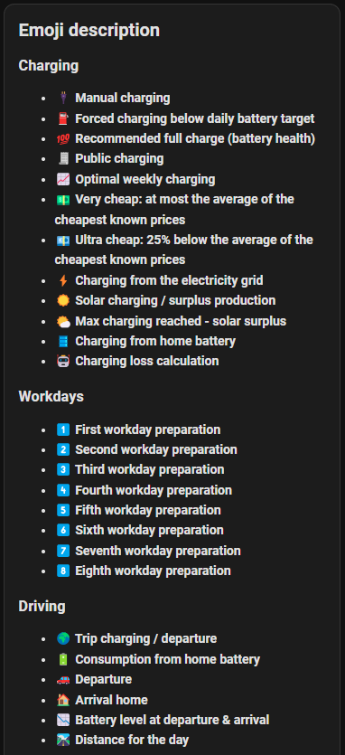

# Emojis

CJP marks every decision with an emoji, so a plan or a history row can be read at a glance. The same emoji
always means the same rule.

## Where they are used

| Where | What the emojis tell |
|---|---|
| `sensor.cjp_<prefix>_current_charging_rule` (dashboard → status) | the rule behind the charging right now, e.g. *Planned charging ⚡💵* or *☀️ Solar charging* |
| The plan in the overview | every charge hour shows the emojis of the rules it is for – e.g. `1️⃣⚡` for grid charging for the next workday |
| The departure plan (overview) | 🚗 departure, 🏠 homecoming, 📉 the battery level at departure and arrival, 🛣️ the day's distance, 🌍 a trip |
| The solar forecast (overview) | ☀️ the surplus per day, 🌅/🌇 sunrise and sunset |
| The charging history | each charge with the rules that were active – e.g. `⚡💵` for planned charging at a very cheap price, `🧾` for a public charge, `❗`/`❌` when the charging had problems |
| The emoji explanation (dashboard → overview) | `sensor.cjp_<prefix>_emoji_description` – the list below in your language |

In testing mode (setup → *Advanced*), every line of the current rule is wrapped in 🧪.

Screenshot of the emoji explanation

## Charging

| Emoji | Meaning | Rule |
|---|---|---|
| ⚡ | Charging from the grid (planned) | |
| ☀️ | Solar charging / surplus production | [Solar surplus charging](rules/solar.md) |
| 🌤️ | Max. charge level reached – the rest is solar surplus | [Solar surplus charging](rules/solar.md) |
| 🛢️ | Charging from the home battery | [Home battery](rules/solar.md#home-battery) |
| 📈 | Optimal weekly charging | [Optimal weekly charging](rules/weekly.md) |
| 💵 | Very cheap power – charged to *charge level for very cheap electricity* | [Cheap power](rules/cheap-power.md) |
| 💶 | Ultra cheap power – charged to *charge level for ultra cheap electricity* | [Cheap power](rules/cheap-power.md) |
| 💯 | Recommended full charge (battery health) | [Full charge](rules/full-charge.md) |
| 🔌 | Manual charging | [Manual charging](rules/manual-forced.md#-manual-charging) |
| ⛽ | Forced charging below the daily battery target | [Forced charging](rules/manual-forced.md#-forced-charging-below-the-daily-battery-level) |
| 🧾 | Public charging | [Public charging](public-charging.md) |
| 🤖 | Charging loss calculation | [Charging loss](charging-loss.md#one-time-measurement) |

## Work plan

| Emoji | Meaning |
|---|---|
| 1️⃣ … 8️⃣ | the charging is for the 1st … 8th upcoming workday of the [work plan](rules/workplan.md) |

## Driving

| Emoji | Meaning |
|---|---|
| 🌍 | Trip charging / the trip's departure – see [Trip](rules/trip.md) |
| 🚗 | Departure |
| 🏠 | Homecoming |
| 📉 | Battery level at departure and homecoming |
| 🛣️ | The day's distance |
| 🔋 | Energy from the home battery |

## Status

| Emoji | Meaning |
|---|---|
| ☠️ | Critical error – the charger charges at max. current as a fail-safe. See [FAQ](faq-troubleshooting.md#logs-and-debug-info) |
| ⚠️ | Charging without a defined rule |
| ❗ | Charging problems – the charger didn't charge and is being restarted |
| ❌ | Charging failed completely – also after the restarts |
| ⛔ | In the current rule: all charging rules are off (charges at max. current like a normal charger), or charging didn't start and the charger is being restarted |

## Info

| Emoji | Meaning |
|---|---|
| 🌅 / 🌇 | Sunrise / sunset |
| ⌛ | Average (W) over the last period |
