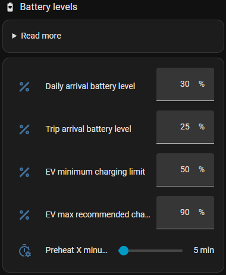

# Getting started

This page takes you from installation to a car that charges by the plan. Plan about 30 minutes, and a few
days of watching the plan before you trust it.

## 1. Check what you need

| You need | Why |
|---|---|
| A charger with **status**, **power** (W) and **kWh** sensors | whether the car is connected and charging, and how much went in |
| [Energi Data Service](https://github.com/MTrab/energidataservice) and/or [Strømligning](https://github.com/MTrab/stromligning) | the prices per hour |
| A way to start/stop the charger (or the car) and set the current from Home Assistant | CJP only decides – your automation does it |

Optional:

- an **EV integration** with battery level, range and odometer (and preferably charge port, charge limit
  and location). Without one, you enter the battery level yourself when you plug in (virtual EV).
- **solar production** (W), [Solcast PV Forecast](https://github.com/BJReplay/ha-solcast-solar) and a weather
  integration with `weather.get_forecasts`
- a **home battery** (level and power)

For the dashboard you need the HACS frontend cards `mushroom`, `apexcharts-card`, `config-template-card`
and `card-mod`.

> [!TIP]
> Before you start, find out how your charger and car are controlled: which services, switches or numbers
> start/stop charging and set the current and the charge limit. Look under *Developer tools → Actions* and
> *States*. You need them in [step 5](#5-control-the-charger).

## 2. Install

1. **HACS** → ⋮ → **Custom repositories**: add `https://github.com/dezito/Cable-Juice-Planner-Integration` as **Integration**.
2. Search for **Cable Juice Planner**, install it, and restart Home Assistant.
3. **Settings → Devices & services → Add integration → Cable Juice Planner → Add EV / charger**.

## 3. Go through the setup

The setup is split into pages. Every field has a help text – here are the ones that matter most.

### Car

- **Name** is used as the device name and in notifications.
- **Prefix:** all entity ids start with `cjp_`. With the prefix `tesla` you get `sensor.cjp_tesla_overview`,
  without one `sensor.cjp_overview`. Use one prefix per car. It can't be changed later.
- **Language** is used for the entity names, the dashboard, the charging rule and notifications. It can be
  changed later under **Configure → General**; the entry reloads and the entity names follow (names you
  renamed yourself are kept).

### Charger

| Field | How to set it |
|---|---|
| Status | the charger's status sensor (`charging`, `completed`, `awaiting_start`, `disconnected` …) |
| Power | the charging power in W |
| kWh meter | if the charger's kWh meter updates slowly (e.g. Easee), make a *Riemann sum integral* (left) of the power sensor and use it |
| Voltage, phases, max. amps | e.g. 230 V, 3 phases, 16 A: limits how many kWh fit in an hour |
| Charging loss | in percent, 0 or negative: −5 means 5 % is lost. CJP can [measure it](charging-loss.md) |

### EV (optional)

Battery level, range and odometer must all be set or all be empty. Skip the page without a car
integration (virtual EV).

- **Battery size:** the usable capacity in kWh.
- **Charge port / cable** and **location** tell whether the car is plugged in at home. Without location,
  CJP uses the charger's status.
- **Charge limit:** the car's current limit. The wanted limit is published as `sensor.cjp_<prefix>_charging_limit`.
- **Climate:** needed for preheating.
- **Hours before departure:** when charging must be done before a departure (default 2).

### House and home battery

- **House consumption:** the house's consumption, not the grid import. Used for the solar surplus.
- **Ignored consumers:** power sensors subtracted from the house – e.g. a heat pump you don't want in the
  forecast. The charger itself is subtracted automatically.
- **Home battery:** level and power, if you have one. See [Solar surplus charging](rules/solar.md#home-battery).

### Prices

Energi Data Service and/or Strømligning. With both, the first one with a price for an hour is used.
Enable *Carnot* in Energi Data Service to plan beyond the published prices – without a forecast, CJP fills
the rest of the week from its own [price database](how-it-works.md#prices).

### Solar panels, solar charging and weather (optional)

Only with solar panels. The defaults work for most. See [Solar surplus charging](rules/solar.md) for the
details, and [Fixed solar sell price](rules/solar.md#fixed-solar-sell-price) if your agreement pays a fixed price.

### Notifications and advanced

- **Notify services:** e.g. `notify.mobile_app_phone`. Use the mobile app for actionable notifications
  (public charging asks for the price).
- **Dashboard** in the sidebar (default on).

Everything can be changed later under **Configure** on the integration.

## 4. Set up the charging rules

Open the dashboard (`/cjp-<prefix>`) → **Settings**. All rules are off after the setup. Start with one:

| Your situation | Start with |
|---|---|
| You drive to work on fixed days | [Work plan](rules/workplan.md): km, departure and homecoming per weekday |
| No fixed pattern, or on holiday | [Optimal weekly charging](rules/weekly.md): the typical daily distance |
| Solar panels | also [Solar surplus charging](rules/solar.md) |

Then set the battery levels: **min. daily battery level** (e.g. 30 %) and **max. recommended charge limit**
(e.g. 90 %). If all rules are off, CJP charges like a normal charger at max. current.

  

## 5. Control the charger

CJP only publishes what should happen: `sensor.cjp_<prefix>_charger_action` (`charge` or `stop`) with the
current per phase and the charge limit. The blueprint that comes with the integration turns it into commands:

1. *Settings → Automations & scenes → Blueprints* → **Cable Juice Planner - charger control** → **Create automation**.
2. Select the car's **Charger action**.
3. Fill in the actions for your charger and/or car. See [Charger and car control](charger-control.md).

> [!TIP]
> Start with the automation **off** and watch `sensor.cjp_<prefix>_charger_action` for a day or two. When
> the plan looks right, turn it on.

## 6. Next steps

- [How CJP plans](how-it-works.md) – the model behind the decisions
- [Recipes](cookbook.md) – settings for typical setups
- [Dashboard and analysis](dashboard-analysis.md) – how to see what the charging costs
