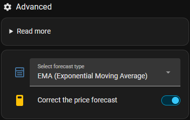

# How CJP plans

This page explains the model behind the decisions. Read it when the car charges at a time you didn't expect.

## The loop

Every few minutes (the **interval**, default 5 min) CJP:

1. reads the car's battery level, the charger, the prices, the consumption history, the solar forecast
   and the settings
2. recalculates the plan for today and the next 7 days – only when something it depends on has changed
3. decides what the charger should do **right now** and publishes it on the
   [action entities](charger-control.md#the-action-entities)

The plan is shown on the dashboard, with a reason for every charge hour and the expected battery level at
each departure.

## What goes into the plan

### The car's need

- **Work plan:** the km per workday, converted to battery % with the car's real consumption, plus the
  **min. daily battery level** at homecoming. See [Work plan](rules/workplan.md).
- **Without a work plan:** the **typical daily distance** every day. See [Optimal weekly charging](rules/weekly.md).
- **Trips:** a percentage or a number of km. See [Trip](rules/trip.md).

### Real consumption

CJP measures every drive (from unplugging to plugging in): km, battery % used and the outdoor temperature.
From that it knows the car's **driving efficiency**, km/kWh and the realistic range – so "50 km" means the
battery % the car really uses, also in winter.

### Solar surplus

With solar panels, the plan uses the forecast **surplus** (production minus the house's consumption) from
Solcast and/or CJP's own history per weather type. The surplus the car can use is subtracted from what has
to be bought. See [Solar surplus charging](rules/solar.md).

### Prices

Buy prices per hour (or 15 minutes) from Energi Data Service and/or Strømligning, and sell prices for the
solar surplus.

**Forecast prices** (e.g. Carnot) get a small adder of 0.033 kr per day ahead, so the plan prefers known
prices. With the switch *Correct the price forecast* on (default, *Settings → Advanced*), they are also corrected with how far off the
forecast was the last 30 days for that day ahead: if the forecast 2 days ahead was 0.15 kr too high on
average, the plan subtracts 0.15 kr. A day ahead is only corrected after 7 days of measurements, and by at
most ±0.50 kr. The [price forecast analysis](dashboard-analysis.md#price-forecast) shows the measurements
and the correction used.

  

CJP also keeps its **own price database**: every day the prices from the price integration are stored per
hour of the day and weekday (only real prices – never the estimates below). It is used when prices are
missing:

- **Hours without a price:** every hour of the plan (today + 7 days) that the price integration has no
  price for gets the forecast of the same hour and weekday from the database. Without a price forecast
  (e.g. Carnot), the published prices usually end tomorrow at midnight, and the rest of the week uses the
  database.
- **The price integration is offline:** the last prices are kept for 2 hours. After that CJP plans the next
  7 days with prices from the database, so charging keeps working until the integration is back.

The hours with prices from the database are listed under *Using offline prices for some hours* in the
overview. The database is part of the [backup](../README.md#backup-export-and-import-of-data).

### What a solar kWh costs

Charging the car with solar is not free: the kWh could have been sold. So a solar kWh costs what it would
have been sold for – the hourly sell price, or with a
[fixed solar sell price](rules/solar.md#fixed-solar-sell-price) `fixed price − hourly sell price`. That
price is used in the charging history, the economy and the cost of the current battery level.

## From plan to action

Every interval the current situation is checked in this order. The first that applies decides:

| Priority | When | The charger |
|---|---|---|
| 1 | all charging rules are off | charges at max. current, like a normal charger |
| 2 | the [charging loss](charging-loss.md#one-time-measurement) is being measured | charges at max. current to the car's limit |
| 3 | [manual charging](rules/manual-forced.md#-manual-charging) is on | charges at max. current – or with the solar surplus only |
| 4 | the car isn't ready to charge (not plugged in at home) | stops |
| 5 | the hour is a planned charge hour | charges at max. current up to the planned level |
| 6 | [forced charging](rules/manual-forced.md#-forced-charging-below-the-daily-battery-level) is on and the battery is below the daily minimum | charges to the daily minimum – except in the 4 most expensive hours of the day |
| 7 | solar charging is on and there is a surplus | charges with the surplus, up to the max. recommended charge limit |
| 8 | none of the above | stops |

The charge limit published for the car follows the rule: the planned level, the cheap power levels, the
daily minimum, or the max. recommended limit.

## When something goes wrong

- **Prices missing:** single hours are filled from the [price database](#prices). If all prices are gone,
  CJP keeps the last prices for 2 hours, then plans entirely with the database.
- **Solcast missing:** the solar forecast uses CJP's own history.
- **The calculation fails:** `mode: error`, and the action becomes `charge` with max. current and the max.
  recommended charge limit. After 3 failures in a row, the integration is reloaded.
- **The charger doesn't charge although it should:** `charger_enabled` is toggled off and on (up to 3
  times), with notifications along the way.
- **The integration stops or hangs:** covered by the [blueprint's fail-safe](charger-control.md#fail-safe).
