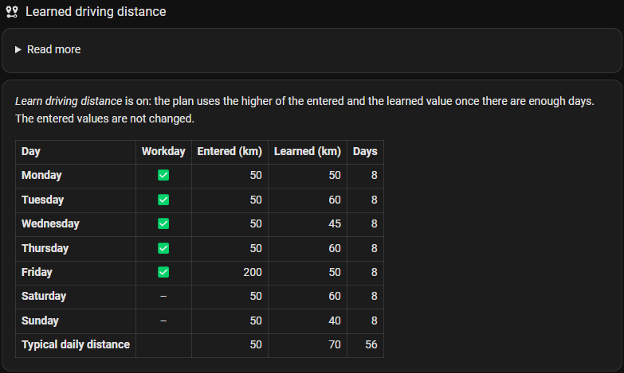

# Learn driving distance

**Switch:** *Learn driving distance* (off by default) · needs an EV integration with an odometer

Instead of guessing the km per workday, CJP can learn them from the odometer.

## How it works

- The odometer is read every evening (23:59). A day's distance is the difference to the evening before.
- From the last **8 weeks** CJP suggests:

  | Number | Suggestion | Why |
  |---|---|---|
  | *km needed* per workday (work plan) | the **median** of that weekday | one long trip doesn't move it |
  | *Typical daily distance* (optimal weekly charging) | the **75th percentile** of all days | a buffer above a normal day |

- The suggestions are rounded up to 5 km and are always shown as the `learned_distance` attribute of the
  number entities – also with the switch off.
- With **Learn driving distance** on, the plan and the overview chart use the **higher** of the entered number
  and the suggestion once there are enough days (at least 14 days for *Typical daily distance*, and 3 of a
  weekday for that weekday's *km needed*); until then they use the entered km. The entered numbers are never
  changed, so a higher distance entered for a single day still counts, and the numbers are as you left them
  when the switch is turned off.
- *Analysis → Learned driving distance* on the dashboard shows the entered and the learned distance per
  weekday side by side, with the number of measured days – see [Dashboard](dashboard-analysis.md#learned-driving-distance).

  

**Example:** the last 8 Tuesdays were 42, 44, 43, 120, 41, 45, 44 and 43 km. The median is 43.5 km, so
the learned distance for Tuesday is 45 km – the 120 km trip doesn't count. With 30 km entered, the plan
uses 45 km; enter 150 km for a long Tuesday and the plan uses 150 km until you lower it again.

Extra driving in a week is covered by the daily arrival battery level.
