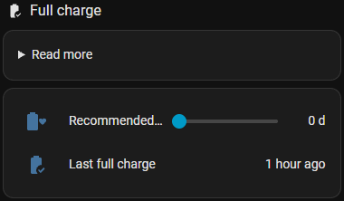

# 💯 Full charge

**Number:** *Recommended full charge every* (days, `number.cjp_<prefix>_full_charge_recommended`, 0 = off) ·
**Sensor:** *Last full charge*

Some LFP batteries need a periodic full charge for battery-management-system calibration. Follow the car
maker's recommendation for how often. The rest of the time the car stays below the max. recommended charge
limit.

  

## How it works

- `sensor.cjp_<prefix>_last_full_charge` is set when the car reaches **100 %**. If charging stops at 99 % and
  the charger remains inactive for 30 minutes while the battery stays at 99 % or more, CJP counts it as
  complete and will not keep retrying the final percentage.
- When more days than *recommended full charge every* have passed, CJP plans a charge to 100 % in the
  cheapest hours until the end of tomorrow – above the max. recommended charge limit.
- Set the number to 0 to switch it off.
