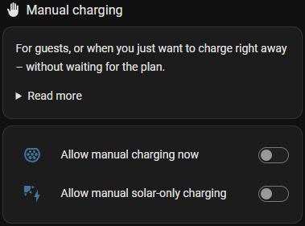
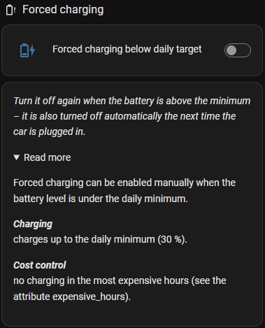

# Manual and forced charging

## 🔌 Manual charging

**Switches:** *Allow manual charging now*, *Allow manual solar-only charging*

Charges at once, without waiting for the plan – e.g. for a guest, or when you need the car sooner than planned.

  

| Switch | The car |
|---|---|
| Allow manual charging now | charges at max. current from the grid (and solar) |
| Allow manual solar-only charging | charges only with the solar surplus |

Both charge up to the max. recommended charge limit, and both are turned off automatically the next time
the car is plugged in.

## 🪫 Forced charging below the daily battery level

**Switch:** *Forced charging below daily target*

When the battery is below the **daily arrival battery level** and no charge is planned right now, the car
charges up to that level at once – except in the **4 most expensive hours** of the day (see the attribute
`expensive_hours`). Then it waits for the next hour.

Use it as a safety net: whatever the plan says, the car never stays below the daily minimum for long.

  

## No rules at all

If every charging rule is off, CJP charges like a normal charger: at max. current whenever the car is
plugged in.
