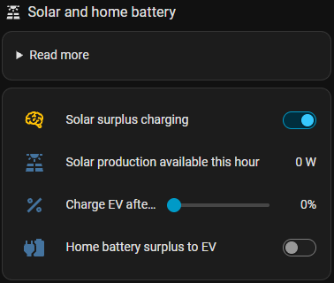

# ☀️ Solar surplus charging

**Switch:** *Solar surplus charging* · only with solar panels configured

The car charges with the solar surplus – the production the house doesn't use – up to the **max.
recommended charging limit**.

  

## How the surplus becomes charging current

Every interval CJP calculates the surplus and turns it into amps:

- **1 or 3 phases:** with a small surplus the car charges on 1 phase, with enough for the 3-phase minimum
  on 3 phases. The limits are set under *Solar charging* in the setup:

  | Setting | Default |
  |---|---|
  | 1-phase min. / max. current | 6 A / 16 A (0 = no 1-phase charging) |
  | 3-phase min. current | 5 A |

- **Borrow from the expected surplus:** the car may use the whole hour's surplus, even if charging only
  starts later in the hour. *Minutes to borrow* (default 15) splits the hour into periods (13:00, 13:15,
  13:30 and 13:45 with 15 min), and the surplus is used within those periods.
- **Allowed difference:** how many watts above (+) or below (−) the surplus the car may charge (default
  −100 W: stay a little below, so nothing is bought).

## In the plan

The expected surplus of the week (Solcast and/or CJP's own history per weather type) is used by the
[work plan](workplan.md) and [optimal weekly charging](weekly.md): grid charging is only planned for what
the sun won't cover before departure.

## Selling in expensive hours

**Setup:** *Solar panels → Enable selling during expensive hours* (default on)

In the day's 4 most expensive hours the surplus is sold instead of charging the car, as long as the car
doesn't need it. This only applies with the hourly sell price – with a fixed solar sell price it is off,
because selling in the expensive hours doesn't pay there (see below).

## Fixed solar sell price

**Setup:** *Solar panels → Fixed solar sell price*

With −1 (default) a solar kWh is worth the hourly sell price.

Some production agreements pay a fixed price, but settle the difference to the raw spot price with you: a
sold kWh is then worth `fixed price − the hour's spot price`. With a fixed price of 1.00 kr:

| Spot price | A sold kWh is worth |
|---|---|
| 0.50 kr | 1.00 − 0.50 = **+0.50 kr** |
| 1.00 kr | **0.00 kr** |
| 5.00 kr | 1.00 − 5.00 = **−4.00 kr** (you pay) |

Set the fixed price here, and CJP values the solar surplus this way – in the plan, the charging history and
the cost of the battery level. When selling costs money, charging the car with the surplus saves it.

## Home battery

With a home battery configured (level and power):

| Setting | Meaning |
|---|---|
| *Charge EV after home battery minimum level* (`number.cjp_<prefix>_ev_charge_after_powerwall_battery_level`) | the solar surplus only charges the car when the home battery is above this level – the home battery is filled first |
| *Home battery surplus to EV* (`switch.cjp_<prefix>_powerwall_discharge_above_needed`) | the car may also be charged **from** the home battery, but only with the energy above the level. Needs solar charging on |

CJP doesn't control the home battery. Create an automation that stops the home battery from discharging
while the car charges, and only allows it while the switch is on and the battery is above the level.
[BattMind's blueprint](https://github.com/dezito/BattMind-Integration/blob/main/docs/actions.md#ev-optional) has
inputs for exactly these two entities.
