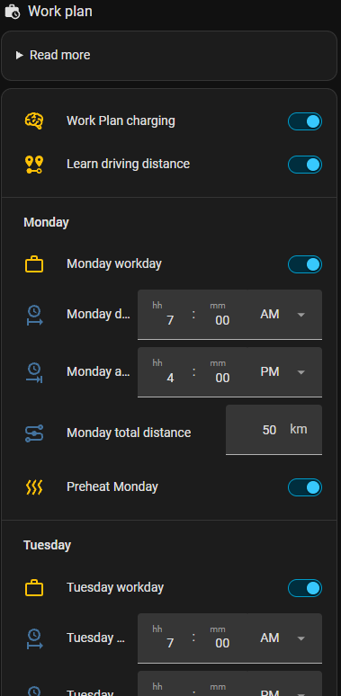

# 🏢 Work plan

**Switch:** *Work Plan charging* · **Per weekday:** *Workday*, *Departure*, *Homecoming*, *km needed*, *Preheat*

For a fixed weekly pattern: CJP makes sure the car has enough for every workday, and charges in the
cheapest hours before each departure.

  

## Settings

| Setting | Meaning |
|---|---|
| Workday (per weekday) | the car drives to work this day |
| Departure / homecoming | when the car leaves and comes home (default 07:00 and 16:00) |
| km needed | the day's round trip in km (default 50). Can be [learned from the odometer](../learn-distance.md) |
| Preheat (per weekday) | preheat the car before departure |
| Daily arrival battery level | the level the car must still have at homecoming (default 30 %) |
| EV max recommended charging limit | the highest level charged to (default 90 %) |
| Preheat X minutes before | how long before departure the preheating starts |
| Hours before departure (setup) | charging must be done this many hours before departure (default 2) |

## How it plans

For each workday CJP calculates:

`need = the day's km in battery % (with the car's real consumption) + daily arrival battery level`

and compares it with the expected level at departure. What is missing is charged in the **cheapest hours
from now until the last charging hour before departure** – solar surplus first, if solar charging is on.
Days off use the [typical daily distance](weekly.md) if *Optimal weekly charging* is on.

**Example:** Thursday is a workday with 60 km, departure 07:00. The car uses 18 kWh/100 km in a 75 kWh
battery, so 60 km ≈ 14 %. With 30 % daily minimum the car needs 44 % at departure. It has 35 % tonight, so
9 % (≈ 7 kWh incl. loss) is charged in the cheapest hours before 05:00.

Very small needs (below 1 % of the battery) are skipped, so the car isn't started for a few hundred Wh.

### While the car is at work

When the car is away on a workday and hasn't come home yet, only the way back (half the distance) is left
for that day.

## Preheating

With *Preheat* on for a weekday (and a car integration with a climate entity), CJP fires
`preheat_start` on `event.cjp_<prefix>_ev_request` before departure – with `departure` and `defrost` (from
the weather forecast or the outdoor temperature) in the data – and `preheat_stop` afterwards. Your
automation starts and stops the climate. See [Charger and car control](../charger-control.md#the-action-entities).

## Together with other rules

- **Solar:** the expected surplus of the week is used, so the car takes as much solar as possible before
  grid charging is planned.
- **Cheap power:** in cheap hours the car may be charged higher than the work plan needs. See [Cheap power](cheap-power.md).
- **Trips** on the same day are added to the need. See [Trip](trip.md).
